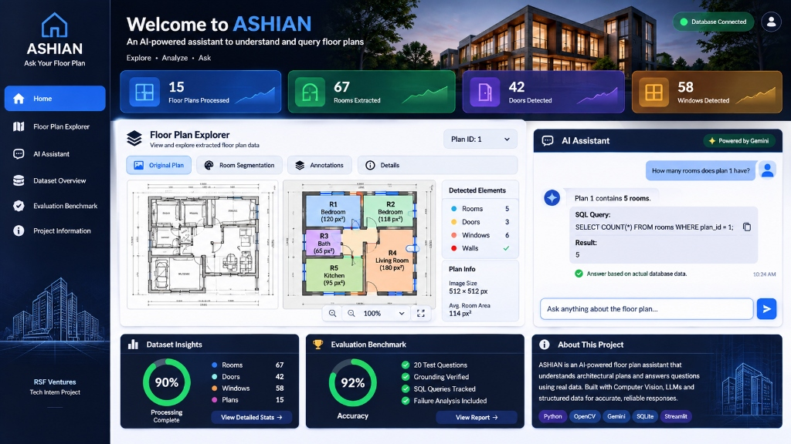
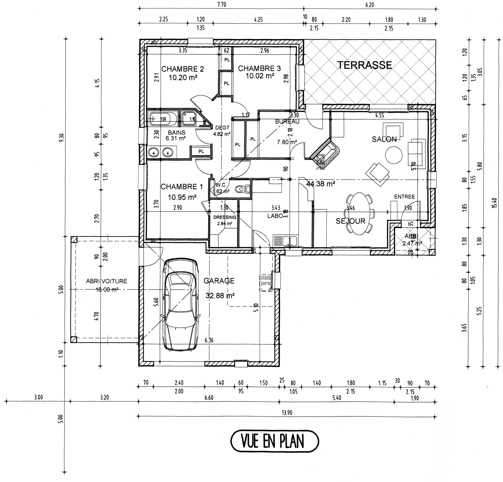
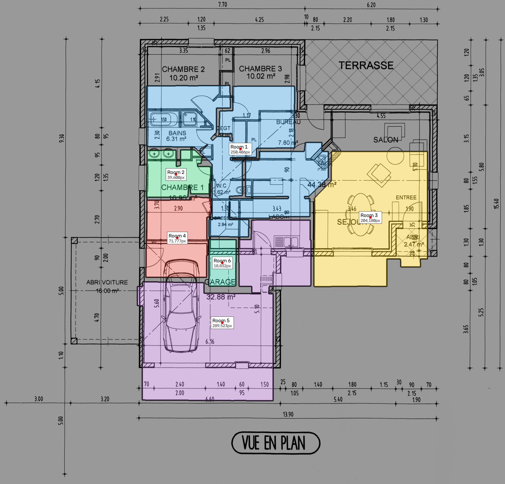
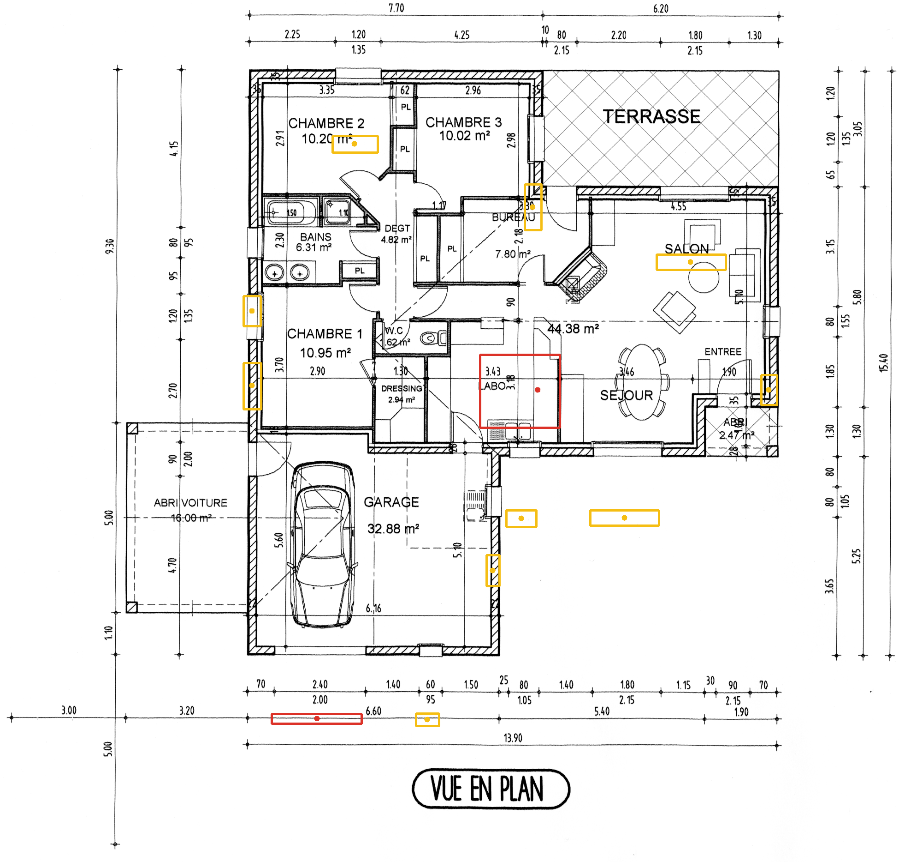
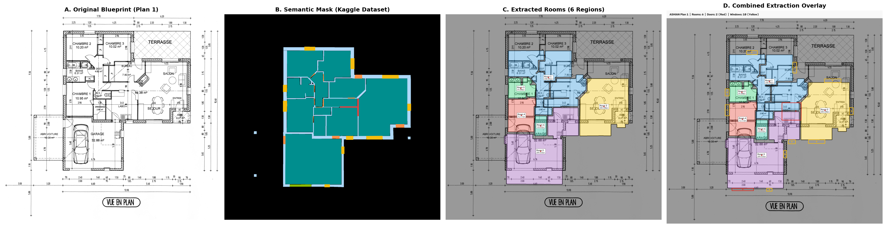

<div align="center">

# ASHIAN
### Ask Your Floor Plan

Computer vision and grounded question answering for architectural floor plans.




</div>

ASHIAN processes architectural floor plans and their color-coded segmentation masks to identify rooms, doors, windows, walls, and room connections. Extracted data is stored in SQLite and explored through a Streamlit dashboard, including a natural-language assistant that answers questions using database evidence.

## Features

- **Floor plan extraction:** Detects room regions, door and window openings, wall regions, bounding boxes, centroids, and door-based room connections from segmentation masks.
- **Interactive dashboard:** Browse available plans, inspect extracted information and visual overlays, and ask questions about the data.
- **Evidence-grounded answers:** Routes common questions through deterministic database queries. Optional Gemini support handles other supported questions.
- **Read-only query checks:** The SQL layer rejects non-`SELECT` statements and chained statements before execution.
- **Evaluation suite:** The checked-in report records 22 of 22 benchmark questions passed. Run the benchmark against the local database to reproduce the evaluation.

## Example Visualizations

| Original plan | Room segmentation |
|:---:|:---:|
|  |  |

| Door and window detections | Combined audit panel |
|:---:|:---:|
|  |  |

## Getting Started

### Requirements

- Python 3.10 or newer
- Git

### Install

```bash
git clone https://github.com/rahulm43/ashian-floorplan-ai.git
cd ashian-floorplan-ai
python -m venv .venv
```

Activate the virtual environment and install dependencies:

```powershell
# Windows PowerShell
.\.venv\Scripts\Activate.ps1
```

```bash
# macOS / Linux
source .venv/bin/activate
```

```bash
python -m pip install --upgrade pip
pip install -r requirements.txt
```

### Run the dashboard

```bash
streamlit run app.py
```

Streamlit prints the local URL when the app starts; the default is <http://localhost:8501>.

The repository includes a SQLite database at `database/ashian.db`, so the dashboard can be explored without configuring an LLM key. To enable Gemini-assisted responses, set `GEMINI_API_KEY` in your environment or create a `.env` file in the project root:

```dotenv
GEMINI_API_KEY=your_api_key
```

Keep API keys private and do not commit `.env` files.

## Process the Dataset

The batch pipeline reads paired plans and masks from `dataset/images/` and `dataset/masks/`, writes extracted JSON records to `outputs/extracted_data/`, stores results in `database/ashian.db`, and generates visualizations in `outputs/visualizations/`.

```bash
python run_pipeline.py
```

The pipeline updates the SQLite database. Back up `database/ashian.db` first if you need to preserve its current contents. The dataset folders should contain corresponding image and mask files; the loader discovers matching pairs.

## Tests and Evaluation

Run the automated tests:

```bash
pytest -v tests/
```

Run the 22-question benchmark using the database currently at `database/ashian.db`:

```bash
python -m src.evaluation
```

The evaluation runner writes its machine-readable results and report under `evaluation/`. The reported benchmark depends on the contents of the local database.

## How It Works

1. **Load:** Discover plan images and corresponding semantic masks.
2. **Analyze:** Match mask colors to semantic classes and use image-processing extractors to find spatial entities.
3. **Store:** Save extracted plan, room, opening, wall, and connectivity data in SQLite; export per-plan JSON records.
4. **Query:** Map natural-language questions to database queries, validate queries, and return answers based on retrieved rows.
5. **Inspect:** View plans, overlays, and extraction results in the Streamlit app.

## Data Scope and Limitations

Area and position measurements are in pixels. The dataset does not provide a reliable physical scale, so the system cannot infer square metres or feet. Room labels are geometric identifiers rather than semantic labels such as “kitchen” or “bedroom.” Materials, wall thickness, elevations, utilities, ownership, and construction details are outside the available data.

Extraction quality depends on the input plan and mask quality. The project is intended for exploration and evaluation, not as a substitute for professional architectural review.

## Repository Layout

```text
.
├── app.py                    # Streamlit dashboard
├── run_pipeline.py           # Batch extraction entry point
├── requirements.txt          # Python dependencies
├── assets/                   # README screenshots and example visualizations
├── database/                 # SQLite database
├── dataset/
│   ├── images/               # Floor plan images
│   └── masks/                # Color-coded segmentation masks
├── docs/                     # Project and demo documentation
├── evaluation/               # Benchmark questions, results, and report
├── outputs/
│   ├── extracted_data/       # Per-plan JSON extraction records
│   ├── reports/              # Generated validation reports
│   └── visualizations/       # Generated overlays and audit panels
├── scripts/                  # Dataset and utility scripts
├── src/                      # Extraction, database, assistant, and UI support modules
└── tests/                    # Automated tests
```

## Technology

Python, OpenCV, NumPy, scikit-image, Pillow, Streamlit, SQLite, pandas, and the Google GenAI SDK.

## License and Data Attribution

No license file is currently included in this repository. Add a `LICENSE` file before describing the project as open source, and verify that the floor-plan images, masks, and other bundled assets may be redistributed under the terms of their original source.
